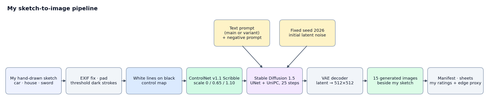
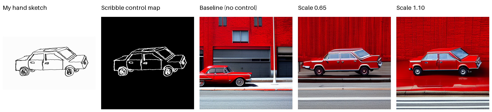
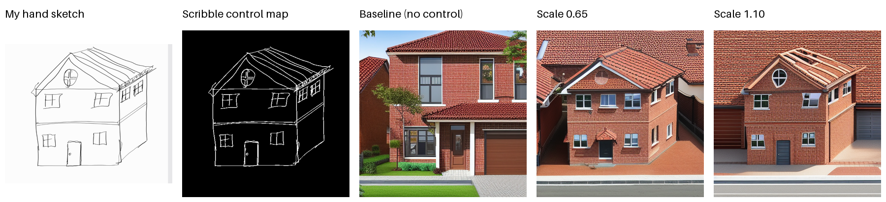
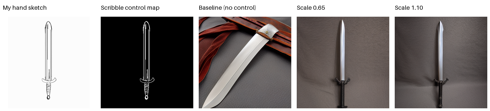
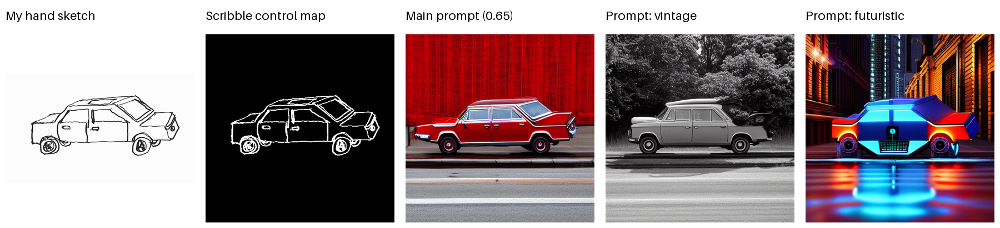
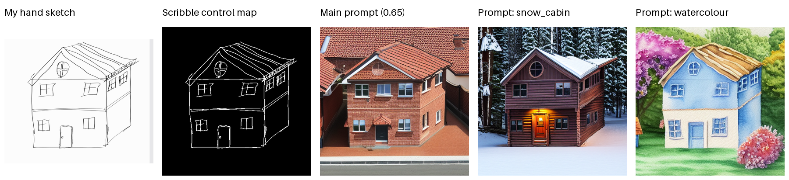
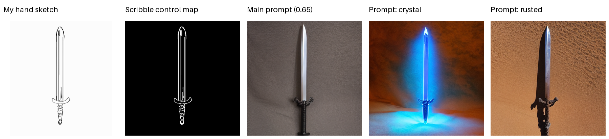

**Code repository:** [REPO LINK]

## 1. What I set out to do

I drew three objects by hand: a car, a house and a sword. I wanted to turn each drawing into a finished image with a pretrained diffusion model, while keeping the shape I'd drawn. My question was how much of my drawing survives once the model invents the materials, lighting and background, and which setting controls that balance.

I built the pipeline in Python with Hugging Face Diffusers, using Stable Diffusion 1.5 as the generator and ControlNet v1.1 Scribble to feed my sketch into it, and ran it on a Google Colab Tesla T4.

## 2. How my sketch influences the output

{width=100%}

**Preprocessing.** ControlNet Scribble expects white lines on a black background, so I convert each photo of my drawing into that format. I apply the phone's rotation flag, pad the photo to a 512 × 512 square without stretching it, convert it to greyscale and mark every pixel darker than 205/255 as a white stroke. I check these control maps by eye before generating; at the default threshold all three were clean, so I didn't need to change it.

**Stable Diffusion.** The model works in a compressed latent space: a VAE turns a 512 × 512 image into a 64 × 64 × 4 latent. Generation starts from random noise in that space, and a UNet removes the noise over 25 steps (UniPC scheduler), guided by my prompt through the CLIP text encoder. The prompt alone only says *what* to draw. It says nothing about *where* things go.

**ControlNet.** This is where my sketch comes in. ControlNet is a trainable copy of the UNet's encoder that reads my control map and adds its features back into the UNet at every denoising step. Those connections are zero-initialised convolutions, so at the start of training ControlNet added nothing and couldn't damage what the base model already knew. The `controlnet_conditioning_scale` multiplies what ControlNet adds: at 0 my sketch has no effect, and larger values push the image harder towards my lines. The scribble map only carries lines, with no colour or shading, so it steers position and outline while the prompt decides materials and colour.

**Fixed settings.** I kept these constant so each comparison changes one thing only: seed 2026 with a fresh generator per image (so every run starts from the same noise), guidance scale 7.0, 25 steps, 512 × 512, fp16 and the negative prompt "poor geometry, blurry, distorted, unreadable text, watermark".

## 3. Experiments

| Experiment | What I change | Images |
|---|---|---|
| 1. Control strength | scale 0.00 (prompt only, my baseline), 0.65 and 1.10, with the main prompt | 3 per sketch |
| 2. Prompt variation | two alternative prompts at scale 0.65 | 2 per sketch |

I picked 0.65 as a middle value that should keep the outline but leave room for detail, and 1.10 to go a little past ControlNet's default of 1.0 and see what happens when the sketch dominates. That's 15 images in total.

I scored every image from 1 to 5 for *structure* (do my silhouette and the positions of its parts survive?), *quality* and *prompt fit*. I also logged an automatic proxy: the share of my stroke pixels lying within 5 pixels of an edge in the generated image.

## 4. Results

### Experiment 1: control strength

{width=100%}

{width=100%}

{width=100%}

| Scale | Structure | Quality | Prompt fit | Edge proxy |
|---|---|---|---|---|
| 0.00 | 1.0 | 3.7 | 3.7 | 0.84 |
| 0.65 | 4.0 | 4.0 | 4.0 | 0.96 |
| 1.10 | 5.0 | 3.3 | 3.3 | 0.98 |

*Mean of my three sketches.*

**At 0.00 my sketch is ignored completely.** The car is cropped at the left edge, the house turns into a flat front view with a garage, and the sword becomes a curved, machete-like blade lying diagonally. They look fine on their own, which is why the baseline matters: everything structural in the other images comes from ControlNet, not the prompt.

**At 0.65 I get the best balance.** All three objects keep my layout. The car keeps its side profile, door split and sloping rear window, and the house keeps my three-quarter view and window positions. The sword is upright with the crossguard and grip where I drew them. The model also reinterprets my wobbly lines sensibly: the bulge I drew at the back of the car became tail fins. The main weakness is colour bleeding: "glossy red paint" turned the whole background wall red.

**At 1.10 the shape matches best, but the images get stiffer.** The house keeps my round attic window exactly, but it also copies the hatching I scribbled on the roof as strange slats. The car looks like a toy, with red now covering the wall and floor. The sword holds up best here, probably because a sword is mostly straight lines that are easy to follow literally.

### Experiment 2: prompt variation

{width=100%}

{width=100%}

{width=100%}

The house gave my best results. The snow cabin and the watercolour cottage both keep my round window, roof line and window grid, while changing material, setting and style completely. So at 0.65 the sketch fixes the geometry and the prompt is free to decide everything else.

The car shows the limit. The vintage version keeps the body and wheels, but my rear-window strokes merge into the trees behind it, and the boot looks broken open. The futuristic prompt pulled hardest against my drawing: it reinterpreted my side view as a symmetric, front-on body. The wheel positions survive but the profile doesn't. A concept-car prompt seems to carry strong ideas about shape, and at 0.65 those ideas can win.

The sword variants show the opposite problem. The outline survives, but parts of the prompt are ignored: the crystal sword glows blue against an orange background rather than a dark cave, and the "rusted" blade still looks like clean steel. With such a thin, simple shape, ControlNet left a lot of the image to the background, and the model filled it with the wrong colours.

Across the six variants I scored structure at 3.3 on average, below the 4.0 of the main prompts at the same scale, while prompt fit stayed at 4.0. The further a prompt moves from what I drew, the more the scale needs to rise to hold the shape.

## 5. Analysis

**The control scale is a trade-off, not a quality dial.** Structure rose steadily from 1.0 to 5.0 as I raised the scale, but quality and prompt fit peaked at 0.65 and fell at 1.10. Past a certain point, ControlNet treats my drawing's mistakes (shaky lines, roof hatching) as things to reproduce. For rough hand drawings, a value in the 0.6–0.8 range looks like the sensible default.

**The edge proxy isn't a reliable measure of sketch preservation.** It does rise with the scale, from 0.84 to 0.98, but the baselines still scored between 0.76 and 0.93 while ignoring my drawing entirely. Busy textures such as brick, tiles and foliage create edges everywhere, so many of my strokes land near *some* edge by chance. The house baseline scored 0.93 for exactly that reason. That's why my own ratings carry the real judgement, and why I'd use a proper metric next time, such as comparing my sketch with edges extracted by an edge detector.

**What I'd try next.** A per-sketch scale (higher for the car's futuristic prompt, lower for the sword), several seeds per setting so I can tell real effects from lucky noise, and cleaning my roof hatching out of the house drawing. The seed point matters: with one seed per setting, some of the differences I describe could change with different starting noise.

## 6. Reproducibility

My models are `stable-diffusion-v1-5/stable-diffusion-v1-5` and `lllyasviel/control_v11p_sd15_scribble` from Hugging Face (CreativeML OpenRAIL-M licence). I ran them on Colab (Tesla T4, Python 3.13, PyTorch 2.14.1, Diffusers 0.39.0, Transformers 4.57.6); `outputs/environment.json` has the full list. To rerun, I open `notebooks/01_sketch_to_image.ipynb` in Colab with a T4 and run the cells in order, or follow the local steps in the README. Prompts and settings are in `experiments.json`, and `outputs/run_manifest.json` records the SHA-256 hash of each input sketch.

## 7. References

- Rombach, R. et al. (2022). *High-Resolution Image Synthesis with Latent Diffusion Models*. CVPR. arXiv:2112.10752.
- Zhang, L., Rao, A. & Agrawala, M. (2023). *Adding Conditional Control to Text-to-Image Diffusion Models*. ICCV. arXiv:2302.05543.
- Ho, J., Jain, A. & Abbeel, P. (2020). *Denoising Diffusion Probabilistic Models*. NeurIPS. arXiv:2006.11239.
- Zhao, W. et al. (2023). *UniPC: A Unified Predictor-Corrector Framework for Fast Sampling of Diffusion Models*. arXiv:2302.04867.
- Hugging Face Diffusers documentation, ControlNet pipeline, and the model cards of both models.

## AI assistance

I used Claude (Anthropic) as an assistant for this project. It helped me write and test the pipeline code and the notebook, suggested the prompts, and helped me draft this report and the first version of my image scores. I drew the sketches, ran the experiments on Colab, checked every image and adjusted the scores and analysis to match what I saw.
