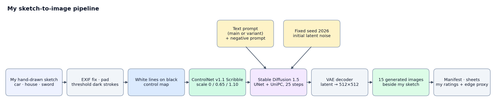
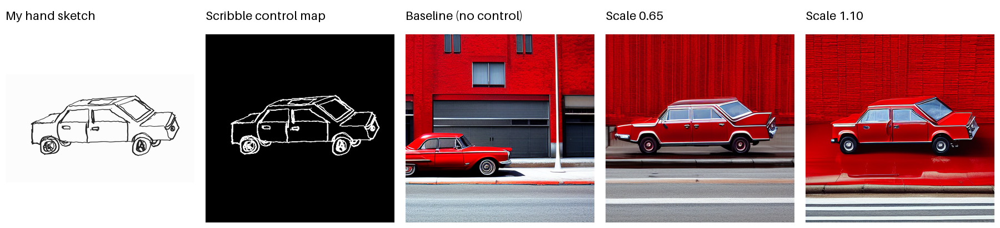

# Bringing Sketches to Life with Generative AI

**Author:** Nosa Peter Inwe
**Course:** Computer Vision and Machine Learning II, Université Paris-Est Créteil (UPEC)
**Professor:** Arezoo Ghodsifard
**Submission deadline:** 20 November 2026

I drew three sketches by hand (a car, a house and a sword) and built a Python pipeline that turns each one into a finished image with Stable Diffusion 1.5 and a Scribble ControlNet. My question is simple: how much of my drawing's structure survives when the model invents everything else, from paint to lighting? I test it two ways, with a fixed seed throughout so the starting noise never changes between runs.

## How the sketch steers the image

Stable Diffusion 1.5 is a latent diffusion model. It doesn't paint pixels directly: a VAE encoder compresses a 512×512 image into a 64×64×4 latent, and a UNet learns to remove noise from that latent step by step. At generation time I start from pure Gaussian noise (fixed by the seed), and the UNet, guided by my text prompt through the CLIP text encoder, denoises it over 25 scheduler steps. The VAE decoder then turns the clean latent back into pixels.

On its own, the text prompt only says *what* to draw, not *where*. That's the job of ControlNet. It's a trainable copy of the UNet's encoder that reads a spatial condition image (for the scribble model, white strokes on black) and adds its features back into the UNet at every denoising step through zero-initialised convolutions. The `controlnet_conditioning_scale` multiplies those added features:

- **0.00:** the ControlNet contributes nothing. The image comes from the prompt alone, so it's my baseline.
- **0.65:** moderate guidance. The layout should follow my lines but the model keeps some freedom.
- **1.10:** strong guidance. The lines should dominate, sometimes at the cost of realism.

Before any of that, my preprocessing (`src/sketch_pipeline.py`) turns the photo of my drawing into the control map. It applies the phone's rotation flag, pads the image to a square without stretching it, converts to greyscale, and marks every pixel darker than a threshold (205/255 by default) as a white stroke on black.



## My experiments

| Experiment | What changes | What stays fixed | Images |
|---|---|---|---|
| 1. Control strength | ControlNet scale 0.00 / 0.65 / 1.10 | prompt, seed, steps, guidance, resolution | 3 per sketch |
| 2. Prompt variation | two alternative prompts | sketch, seed, scale (0.65), steps, guidance | 2 per sketch (+ the main prompt at 0.65 from experiment 1) |

That's 15 generated images in total. Changing one thing at a time is the point: if I changed the prompt and the strength together, I couldn't say which one caused a difference.

| Sketch | Main prompt | Variant 1 | Variant 2 |
|---|---|---|---|
| Car | modern red car on a city street, daylight | vintage 1960s car, black-and-white film photo | futuristic electric concept car, neon city at night |
| House | two-storey brick house with a front garden | wooden cabin in a snowy forest at dusk | watercolour cottage with a flower garden |
| Sword | medieval steel longsword, studio product shot | glowing blue crystal fantasy sword | rusted iron sword half-buried in sand |

The exact prompt text lives in `experiments.json`.

## Settings I use

| Setting | Value |
|---|---|
| Base model | [`stable-diffusion-v1-5/stable-diffusion-v1-5`](https://huggingface.co/stable-diffusion-v1-5/stable-diffusion-v1-5) |
| Control model | [`lllyasviel/control_v11p_sd15_scribble`](https://huggingface.co/lllyasviel/control_v11p_sd15_scribble) (ControlNet v1.1 Scribble) |
| Scheduler | UniPC multistep, 25 steps |
| Classifier-free guidance | 7.0 |
| Resolution | 512 × 512 |
| Seed | 2026 (fresh CPU generator for every image) |
| Negative prompt | poor geometry, blurry, distorted, unreadable text, watermark |
| Sketch threshold | 205 / 255 |
| Precision | float16 on GPU |

## Running it

### On Google Colab (what I used)

1. Upload `notebooks/01_sketch_to_image.ipynb` to [Colab](https://colab.research.google.com) and choose **Runtime → Change runtime type → T4 GPU**.
2. Run the cells in order. The project code is built into the notebook, so the only upload is my three sketches (file names containing `car`, `house` and `sword`).
3. The dry-run cell shows each sketch beside its control map. I check them before generating; if a shadow shows up as a white blob I lower the threshold, and if lines go missing I raise it.
4. The generation cell downloads the models from Hugging Face on the first run, then makes the 15 images.
5. The last cell downloads `sketch_results.zip` with everything in `outputs/`.

### Locally (needs a CUDA GPU with enough memory; my laptop's 3 GB card isn't enough)

```bash
python -m venv .venv
.venv\Scripts\activate            # macOS/Linux: source .venv/bin/activate
python -m pip install -r requirements.txt
python -m pytest -q
python -m src.run_experiments --dry-run
python -m src.run_experiments --generate
```

My drawings go in `data/sketches/` as `01_car.png`, `02_house.png` and `03_sword.png`.

## What a run produces (`outputs/`)

- `*_control.png`: the processed control map for each sketch.
- `*_control_0.00.png`, `*_control_0.65.png`, `*_control_1.10.png`: experiment 1.
- `*_prompt_<name>.png`: experiment 2.
- `*_comparison.png` and `*_prompts.png`: side-by-side sheets (my sketch, control map, results).
- `run_manifest.json` and `run_summary.csv`: every prompt, seed, scale, model ID and the SHA-256 of each input sketch.
- `environment.json`: exact library versions and the GPU name.
- `human_review_template.csv`: where I score each image 1–5 for structure, image quality and prompt fit, with one concrete strength and failure.

## How I judge the results

Mostly by eye, against my own drawing. A 5 for structure means the main silhouette and the spatial relations between parts survive; a 3 means some features match but important geometry moved; a 1 means the shape is gone. A beautiful image that ignores my sketch doesn't get a high structure score.

I also log an *edge-proximity proxy*: the share of my stroke pixels that sit within 5 pixels of an edge in the generated image. It helps me compare strengths on the same sketch, but it's crude. Busy textures like brick or foliage create edges everywhere and inflate it, so I never treat it as a similarity score.

## Limits I'm aware of

- A fixed seed makes runs repeatable on the same setup, but different GPUs or library versions can still give slightly different images.
- Shadows in a phone photo can turn into fake strokes; I check the control maps before generating.
- Stable Diffusion 1.5 has known weaknesses (hands, text, fine detail) and inherits biases from its training data.
- The scribble model was trained on rough line drawings, so very detailed shading in a sketch doesn't help it.
- My tests (`tests/`) check preprocessing, configuration and bookkeeping with a fake pipeline. They don't test image quality; only the real run does that.

## My web app (bonus)

The experiments answer my question; the web app lets anyone try it. I built it in Gradio (`src/gradio_app.py`). I can draw a sketch straight on a 512 × 512 canvas in the browser, or upload a photo of a pen drawing. The page shows the control map ControlNet actually sees, with an ink check that warns me before a shadowy photo wastes a generation, then generates with my prompt, strength, seed and step count. Buttons fill in my three main prompts.

It reuses my preprocessing and settings, so a drawing at strength 0.65 with seed 2026 goes through the same steps as my experiment runs.

**On Colab (how I run it):** open `notebooks/02_web_app.ipynb`, pick a T4 GPU and run the four cells. The last one prints a temporary public `gradio.live` link.

**Locally** (needs a CUDA GPU with enough memory):

```bash
pip install -r requirements.txt -r requirements-ui.txt
python app.py            # add --share for a public link
```

`tests/test_gradio_app.py` checks the app's logic with a fake model: canvas flattening, choosing between a drawing and an upload, input checks, and that my settings reach the model unchanged.

## References

- Rombach, R., Blattmann, A., Lorenz, D., Esser, P. & Ommer, B. (2022). *High-Resolution Image Synthesis with Latent Diffusion Models*. CVPR. https://arxiv.org/abs/2112.10752
- Zhang, L., Rao, A. & Agrawala, M. (2023). *Adding Conditional Control to Text-to-Image Diffusion Models*. ICCV. https://arxiv.org/abs/2302.05543
- Ho, J., Jain, A. & Abbeel, P. (2020). *Denoising Diffusion Probabilistic Models*. NeurIPS. https://arxiv.org/abs/2006.11239
- Zhao, W. et al. (2023). *UniPC: A Unified Predictor-Corrector Framework for Fast Sampling of Diffusion Models*. https://arxiv.org/abs/2302.04867
- Stable Diffusion v1.5 model card and CreativeML OpenRAIL-M licence: https://huggingface.co/stable-diffusion-v1-5/stable-diffusion-v1-5
- ControlNet v1.1 Scribble model card: https://huggingface.co/lllyasviel/control_v11p_sd15_scribble
- Hugging Face Diffusers, ControlNet pipeline: https://huggingface.co/docs/diffusers/api/pipelines/controlnet
- Hugging Face Diffusers, reproducibility and seeds: https://huggingface.co/docs/diffusers/using-diffusers/reusing_seeds
- Libraries: PyTorch, Diffusers, Transformers, Accelerate, Pillow, NumPy, pytest, Streamlit. Exact versions for my run are in `outputs/environment.json`.
- Sketches: all three are my own drawings.

## My results and report

My T4 run is committed in `outputs/`. The full write-up, with every sketch beside its generated images, is in [`report/REPORT.md`](report/REPORT.md) (Word and PDF versions sit next to it). My image scores are in `outputs/human_review_draft.csv`.



## AI assistance

I used Claude (Anthropic) as an assistant for this project. It helped me write and test the pipeline code, the notebook and this README, suggested the prompts, and helped me draft the report and the first version of my image scores. I chose the subjects, drew the sketches, ran the experiments on Colab and checked every result, and I can explain every part of the code.
