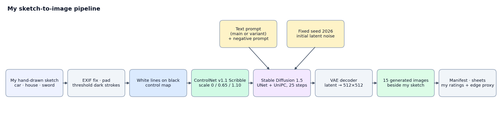
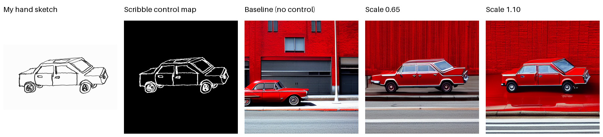
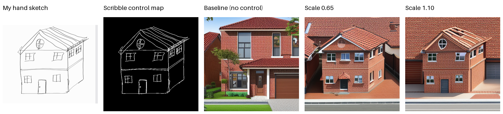
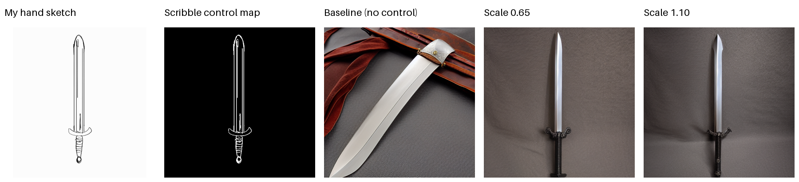
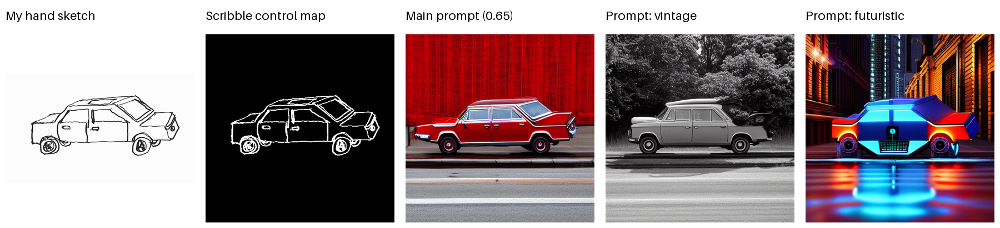
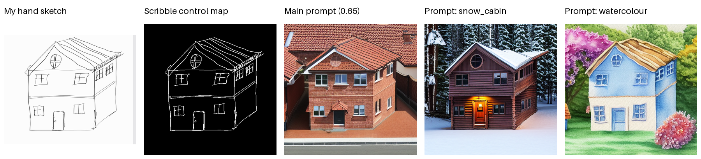
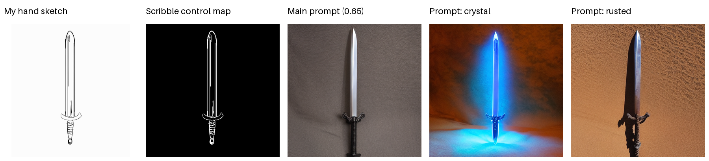

**Code repository:** <https://github.com/nosainwe/gen-ai-projects/tree/main/sketch-to-image-controlnet>

## 1. What I set out to do

I drew a car, a house and a sword in pen on plain paper. The plan: push each drawing through a pretrained diffusion model and get a finished image back without losing the shape I'd drawn. That's harder than it sounds, because a diffusion model will happily invent a gorgeous car but has no reason to put it where my lines are.

So my question was which setting decides how much of my drawing survives, and what that costs in image quality.

I built the pipeline in Python with Hugging Face Diffusers, using Stable Diffusion 1.5 as the generator and ControlNet v1.1 Scribble to carry my sketch into it. My laptop's GTX 1050 has 3 GB of VRAM, which isn't enough for both models, so I ran the final experiments on a free Google Colab Tesla T4 on 19 November 2026. The first version of my notebook tripped me up there. It expected a zip of the whole project and crashed with a `StopIteration` when I uploaded plain sketches, so I rebuilt it with the code inside the notebook. Now the drawings are the only upload.

## 2. How my sketch influences the output

{width=100%}

ControlNet Scribble wants white lines on black. My photos are the opposite, so my code flips them: it applies the phone's rotation flag, pads the photo onto a white 512 × 512 square without stretching it, converts it to greyscale and marks every pixel darker than 205/255 as a white stroke. I checked all three control maps by eye before generating. They came out clean at the default threshold, with no shadow blobs, so I left it at 205.

Stable Diffusion doesn't paint pixels. A VAE squeezes a 512 × 512 image into a 64 × 64 × 4 latent, and generation happens in that smaller space: the run starts from random noise, and a UNet strips the noise away over 25 UniPC steps while the CLIP text encoder feeds it my prompt. At the end the VAE decoder turns the clean latent back into pixels. The prompt says what to draw. Not where.

That's the gap ControlNet fills. It's a trainable copy of the UNet's encoder that reads my control map and adds its features into the UNet at every denoising step, through convolutions that started training at zero so they couldn't wreck what the base model already knew. The `controlnet_conditioning_scale` multiplies that contribution: at 0 my sketch does nothing, and higher values pull the image harder onto my lines. Because the map carries lines only, with no colour or shading, it decides position and outline while the prompt decides materials and colour.

Everything else stayed fixed, so each comparison changes one thing: seed 2026 with a fresh generator per image (the same starting noise every time), guidance scale 7.0, 25 steps, 512 × 512, fp16, and the negative prompt "poor geometry, blurry, distorted, unreadable text, watermark".

## 3. Experiments

| Experiment | What I change | Images |
|---|---|---|
| 1. Control strength | scale 0.00 (prompt only, my baseline), 0.65 and 1.10, with the main prompt | 3 per sketch |
| 2. Prompt variation | two alternative prompts at scale 0.65 | 2 per sketch |

I chose 0.65 as a middle value, and 1.10 to go slightly past ControlNet's default of 1.0, where I expected the sketch to start dominating. Fifteen images in total.

Each image got a structure score from 1 to 5: do my silhouette and the positions of its parts survive? I scored image quality and prompt fit on the same scale. Alongside that I logged an automatic proxy, the share of my stroke pixels sitting within 5 pixels of an edge in the generated image. It turned out to be close to useless; section 5 explains why.

## 4. Results

### Experiment 1: control strength

{width=100%}

{width=100%}

{width=100%}

| Scale | Structure | Quality | Prompt fit | Edge proxy |
|---|---|---|---|---|
| 0.00 | 1.0 | 3.7 | 3.7 | 0.84 |
| 0.65 | 4.0 | 4.0 | 4.0 | 0.96 |
| 1.10 | 5.0 | 3.3 | 3.3 | 0.98 |

*Mean of my three sketches.*

At 0.00 the model ignores my sketch. Completely. The car sits cropped at the left edge, the house turns into a flat front view with a garage I never drew, and the sword becomes a curved, machete-like blade lying on a diagonal. They're decent images on their own, and that's exactly why the baseline matters: everything structural in the other twelve images comes from ControlNet.

0.65 gave me the best balance. The car keeps its side profile, its door split and the sloping rear window, and the bulge I drew at the back turned into tail fins, which is a better reading of my wobbly line than I'd have managed myself. The house holds my three-quarter view and window positions; the sword stands upright with the crossguard and grip where I put them. The cost is colour bleed. "Glossy red paint" turned the entire background wall red.

At 1.10 the outline matches best and the images get worse. The house keeps my round attic window exactly, but it also reproduces the hatching I scribbled on the roof as a row of strange slats. The car looks like a toy, with red flooding the wall and the floor. The sword copes best of the three because it's almost all straight lines, and straight lines are easy to copy literally.

### Experiment 2: prompt variation

{width=100%}

{width=100%}

{width=100%}

The house won this round. The snow cabin and the watercolour cottage both keep my round window and window grid, yet swap brick for logs or paint, and daylight for dusk or pastel. At 0.65 the sketch fixes the geometry and the prompt owns everything else.

The car is where it broke. The vintage version keeps the body and wheels, but my rear-window strokes melt into the trees behind it and the boot looks smashed open. The futuristic prompt fought my drawing hardest: it rebuilt my side view as a symmetric, front-on body, keeping the wheel positions and throwing away the profile. "Concept car" carries strong ideas about shape, and at 0.65 those ideas beat my lines.

The sword failed the other way round. Its outline survived both prompts; the prompts didn't. The crystal blade glows blue against orange rock instead of a dark cave, and the "rusted" sword is clean steel lying in sand. A thin shape leaves most of the frame to the background, and the model filled it with the wrong colours.

Across the six variants, structure averaged 3.3 against 4.0 for the main prompts at the same scale, while prompt fit held at 4.0. The further a prompt drifts from what I drew, the higher the scale has to go to hold the shape.

## 5. Analysis

The control scale is a trade-off, not a quality dial. Structure climbed from 1.0 to 5.0 as I raised it; quality and prompt fit peaked at 0.65 and dropped at 1.10. Push past that point and ControlNet starts reproducing my drawing's mistakes, the shaky lines and the roof hatching, as if they were design decisions. For rough hand drawings I'd start at 0.65 and only go higher when a prompt fights the shape, as the futuristic car did.

The edge proxy doesn't measure sketch preservation. It rises with the scale, from 0.84 to 0.98, but the three baselines scored between 0.76 and 0.93 while ignoring my drawings entirely. Brick, roof tiles and foliage put edges everywhere, so plenty of my strokes land near some edge by pure chance; the house baseline reached 0.93 that way. My own ratings carry the judgement here. Next time I'd replace the proxy with something stricter, such as matching my strokes against Canny edges taken from the output.

As for next steps, I'd give each sketch its own scale, run several seeds per setting, clean the hatching out of my house drawing and add that stricter edge metric. The seeds matter most. With one seed per setting, I can't rule out that some of the differences above come from lucky noise rather than the setting itself.

## 6. Reproducibility

My models are `stable-diffusion-v1-5/stable-diffusion-v1-5` and `lllyasviel/control_v11p_sd15_scribble` from Hugging Face (CreativeML OpenRAIL-M licence). I ran them on Colab (Tesla T4, Python 3.13, PyTorch 2.14.1, Diffusers 0.39.0, Transformers 4.57.6); `outputs/environment.json` has the full list. To rerun, I open `notebooks/01_sketch_to_image.ipynb` in Colab with a T4 and run the cells in order, or follow the local steps in the README. Prompts and settings live in `experiments.json`, and `outputs/run_manifest.json` records the SHA-256 hash of each input sketch.

## 7. References

- Rombach, R. et al. (2022). *High-Resolution Image Synthesis with Latent Diffusion Models*. CVPR. arXiv:2112.10752.
- Zhang, L., Rao, A. & Agrawala, M. (2023). *Adding Conditional Control to Text-to-Image Diffusion Models*. ICCV. arXiv:2302.05543.
- Ho, J., Jain, A. & Abbeel, P. (2020). *Denoising Diffusion Probabilistic Models*. NeurIPS. arXiv:2006.11239.
- Zhao, W. et al. (2023). *UniPC: A Unified Predictor-Corrector Framework for Fast Sampling of Diffusion Models*. arXiv:2302.04867.
- Hugging Face Diffusers documentation, ControlNet pipeline, and the model cards of both models.

## AI assistance

I used Claude (Anthropic) on this project. It helped me write and test the pipeline code and the notebook, suggested the prompts, and drafted this report and a first pass of my image scores with me. I drew the sketches and ran the experiments on Colab. Then I went through every image myself and corrected the scores and the analysis wherever they didn't match what I saw.
